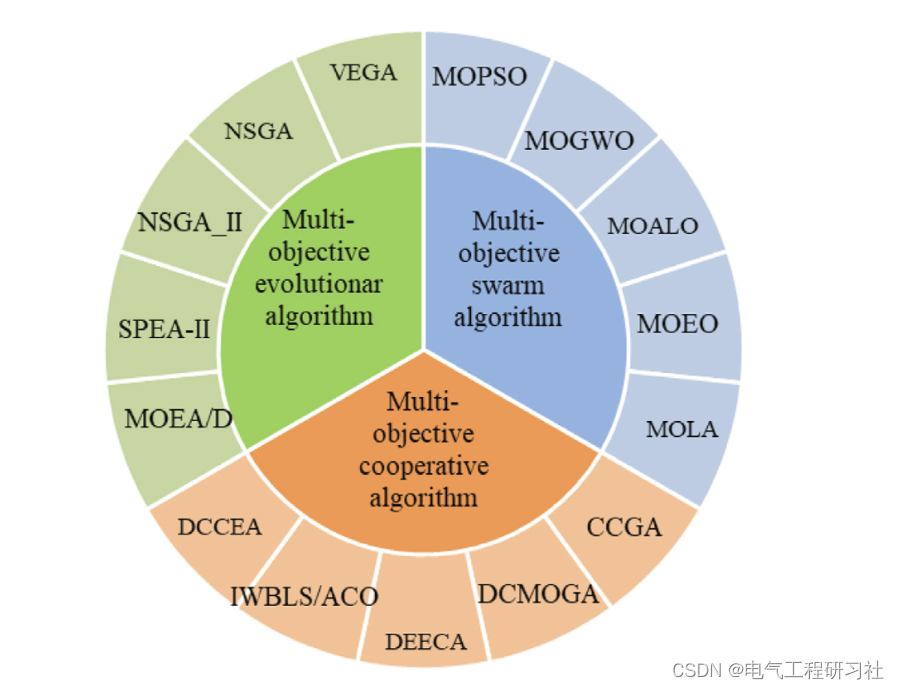
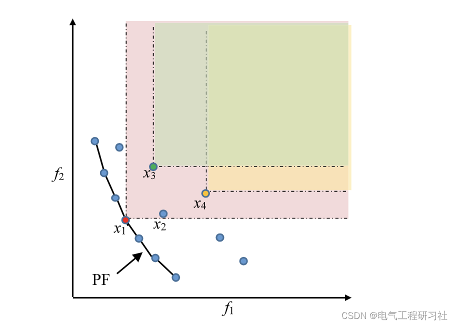
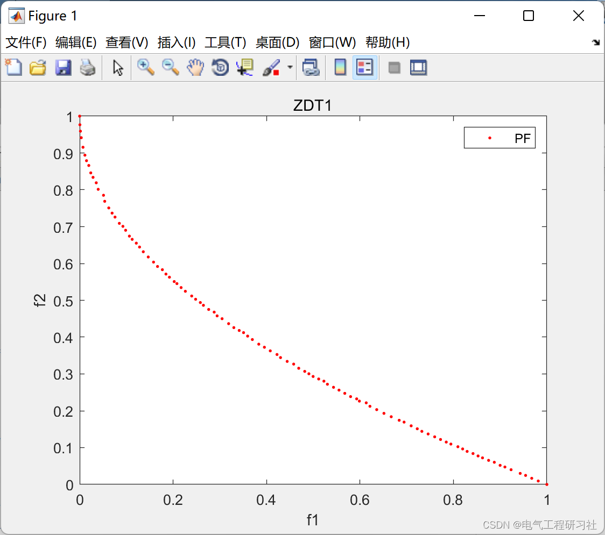
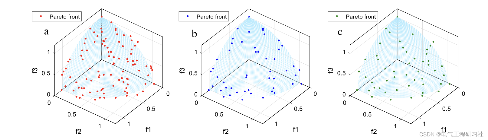

# Multi-objective Optimization Algorithm | A Multi-Objective Artificial Bee Colony Algorithm Based on Dynamic Elimination and Crowd Distance, for Solving Engineering Design Problems (Matlab Code Implementation)

1. Overview of the Artificial Bee Colony (ABC) algorithm, a recently developed bio-inspired heuristic algorithm that exhibits outstanding performance in solving single-objective optimization problems. Despite its advantages, this algorithm can only address one objective problem. To tackle complex multi-objective optimization problems, including engineering design issues, this study develops a Multi-Objective ABC (MOAHA). In MOAHA, an external archive is utilized to store Pareto-optimal solutions, and a dynamic elimination of crowding distance (DECD) method is developed to maintain the archive effectively, thus preserving population diversity. Furthermore, a non-dominance sorting strategy is integrated with MOAHA to construct a solution updating mechanism, effectively refining Pareto-optimal solutions and enhancing the convergence of the algorithm. A comprehensive set of tests has demonstrated superior results over seven competitors across 28 benchmark functions in terms of convergence, diversity, and distribution of solutions. The MOAHA algorithm has also been applied to five real-world multi-objective engineering design problems, showcasing its superiority in handling challenging real-world multi-objective problems characterized by unknown true Pareto-optimal solutions and frontiers.
Over the past few decades, various optimization methods have been gradually developed to tackle challenging optimization problems. These optimization algorithms draw inspiration from various aspects of nature, including biological evolution, social and group behaviors in organisms, physical or chemical phenomena, and human-related actions and ideologies. Representative algorithms include Genetic Algorithm (GA) [1], Particle Swarm Optimization (PSO) [2], Ant Colony Optimization (ACO) [3], Artificial Bee Colony (ABC) [4], and Cuckoo Search (CS) [5]. Recently, some highly praised new algorithms have also been developed, such as Whale Optimization Algorithm (WOA) [6], Butterfly Optimization Algorithm (BOA) [7], Teaching-Learning Based Optimization (TLBO) [8], Mud Mold Algorithm (SMA) [9], Salp Swarm Algorithm (SSA) [10], Bat Fly foraging Optimization (MRFO) [11], and Balanced Optimizer (EO) [12]. Since their introduction, these algorithms have received much attention in the literature. The improved versions of these new optimizers are designed to address various engineering problems. For global optimization problems, a hybrid optimizer combining butterflies and pollination is proposed [13]; an optimizer that combines EO and SMA's strengths is provided for engineering applications, using the enhanced MRFO to solve the CCG-Ball curve problem [15]; and the Enhanced Prophet with PFAS (PFA) is applied to engineering design [16], [17]. The above optimizers are single objective optimization algorithms (SOA). However, in scientific research and engineering practice, many real-world problems often inherently have multiple objectives, making them difficult to solve. Multi-objective optimization problems (MOP), which involve several objectives to be optimized simultaneously, are common in science and engineering [18], [19], [20]. Designing specific tools to address these problems is necessary because the multiple objectives of MOP often conflict and limit each other. Over the past thirty years, many multi-objective optimization algorithms (MOAs) have been proposed and developed as powerful tools to tackle various challenging MOPs in various engineering fields [21], [22], [23], [24], [25], [26]. Clearly, in these issues, the importance and priority of each objective are determined by the decision-makers. Based on the availability of this expertise, MOAs can be categorized into three types: Prioritized, Post-Optimized, and Interactive [27].
Editor
Another widely used MOEA is the Intensity Pareto Evolutionary Algorithm (SPEA) [45]. SPEA establishes a archive population to preserve previously obtained non-dominated solutions for subsequent selection, while employing parameter-based Pareto-based techniques to preserve population diversity. SPEA-II is an improved version of SPEA [46]. In addition to enhancing the archive truncation technique of SPEA, SPEA-II also combines fine-grained adaptive allocation and density evaluation strategies to improve the convergence and distribution of solutions [47]. Like SPEA and SPEA-II, the Pareto envelope selection algorithm (PESA) [48] and its enhanced PESA-II [49] are another set of household MOEAs. The similarities between PESA and PESA-II lie in their use of smaller internal populations and larger external populations to emphasize solutions with higher diversity, whereas the difference lies in PESA-II adopting a region-based rather than individual-based selection. SPEA-II uses a grid assignment strategy to maintain population diversity, and has good search capabilities for true solutions.
This article is structured as follows. Section 2 introduces the concept of MOP. Section 3 discusses the original AHA and its multi-objective version, MOAHA. Section 4 explores the performance of MOAHA using various test functions. In Section 5, five engineering cases are used to verify the effectiveness of MOAHA and detailed Matlab code and reading of the article are provided. Section 6 concludes the paper with a few future directions.
Editor
Migratory Foraging: When the food source for hummingbirds becomes scarce, they often migrate to areas away from their current foraging grounds. In AHA, the most adaptable hummingbirds engage in migratory foraging. Additionally, a migration coefficient is defined to control when migratory foraging occurs. The mathematical model for migratory foraging is as follows:
Detailed mathematical models and explanations are provided in Part 4.
3. Running Results Editing
Editor
4. Read the Matlab code and article in detail. This article only displays the main function part of the code, all the code and detailed articles can be found in:  
Edit
%--------------------------------------------------------------------------%
​  

## Images

<!-- PAYMENT_BLOCK -->

## Get this dataset

- Payment link (Stripe): [Buy now](https://buy.stripe.com/3cs8yP7sY87d0vu9AB)
- Payment QR code: 

<!-- /PAYMENT_BLOCK -->
